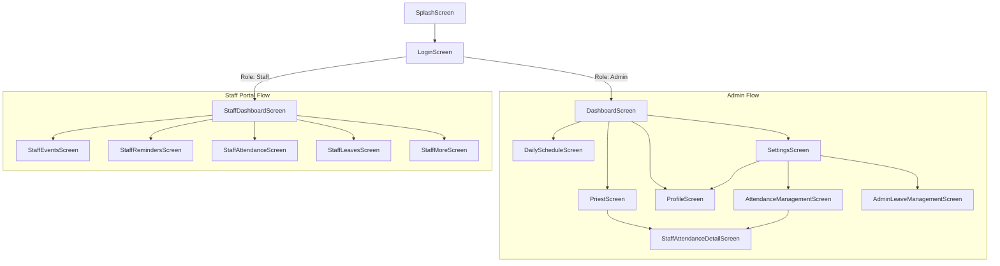

# Manthiragiri Jothidam — Screen & Feature Audit

**Document Version:** 1.0.0  
**Project:** Manthiragiri Jothidam (மாந்திரகிரி ஜோதிடம்)  
**Target Audience:** Backend Engineering Team & Mobile Integration Engineers  
**Classification:** Technical Architecture Specification  

---

## 1. Executive Summary & Application Scope

**Manthiragiri Jothidam** is a specialized React Native application serving Vedic astrology consultations, temple poojas, outdoor rituals, priest and assistant allocation, attendance tracking, leave governance, and payment ledgers. 

The application currently features two distinct user experiences inside the same mobile binary:
1. **Admin Portal**: Chief Administrator (சிவஸ்ரீ சுந்தரமூர்த்தி குருக்கள் - Chief Administrator / Head Priest) managing the entire institution, allocating priests, reviewing leaves, tracking daily schedules, and viewing financial balances.
2. **Staff Portal**: Dedicated operational space for Priests (தலைமை, அர்ச்சகர், புரோகிதர்) and Assistants (உதவியாளர், வேத உதவியாளர்) to record daily self-attendance, inspect assigned rituals, mark completions, manage task reminders, and submit leave applications.

This document performs an exhaustive audit of all 16 screens and key modal dialogs in the codebase, identifying data flows, user actions, input schemas, dropdown sources, static/mock dependencies, and required backend operations.

---

## 2. Global Navigation Architecture

The app uses React Navigation (`@react-navigation/native-stack`) defined in [`src/navigation/RootNavigator.tsx`](file:///d:/keerthik/WORK/mandragirijothidam/src/navigation/RootNavigator.tsx) with route parameters typed in [`src/types/navigation.ts`](file:///d:/keerthik/WORK/mandragirijothidam/src/types/navigation.ts).

---

## 3. Comprehensive Screen-by-Screen Audit

---

### 3.1. Splash Screen
- **File Path:** [`src/screens/splash/SplashScreen.tsx`](file:///d:/keerthik/WORK/mandragirijothidam/src/screens/splash/SplashScreen.tsx)
- **Role Access:** Public / Pre-Authentication
- **Data Displayed:**
  - Sacred branding video (`src/assets/videos/splash.mp4`) with fallback logo (`src/assets/images/logo.png`).
  - Vedic brand emblem and institution title.
- **User Actions:** None (Auto-navigates on video completion or 2500ms timeout fallback).
- **Current Mock / Hardcoded State:** Video playback timer.
- **Existing API Dependencies:** None.
- **Backend Operations Required:**
  - System status & app configuration check (`GET /api/v1/system/config`).
  - Active session restoration via stored JWT token in `@mandhragiri_auth_session_v1`.
- **Navigation Destination:**
  - If valid token found: Route to `Dashboard` (Admin) or `StaffDashboard` (Staff).
  - If unauthenticated: Route to `Login`.

---

### 3.2. Sacred Vedic Sign-In / Login Screen
- **File Path:** [`src/screens/auth/LoginScreen.tsx`](file:///d:/keerthik/WORK/mandragirijothidam/src/screens/auth/LoginScreen.tsx)
- **Role Access:** Public
- **Data Displayed:**
  - Auspicious top insignia: `• ஓம் சாந்தி` (Tamil) / `• OM SHANTI` (English).
  - Language toggle pill: `தமிழ் | English`.
  - Sacred gold halo with institution emblem.
  - Headings: Two-line Tamil `மாந்திரகிரி\nஜோதிடம்` or luxury serif `Mandhragiri Jothidam`.
  - Role switcher divider: `உள்நுழைவு வகை` / `SIGN IN AS`.
  - Role selector buttons: `நிர்வாகி` (Admin) and `புரோகிதர்` (Priest & Assistant).
  - Mobile input with `IN +91` badge.
  - Password input with masked bullets and visibility toggle (`Eye` / `EyeOff`).
  - Italic sacred gold link: `கடவுச்சொல் மறந்துவிட்டதா?` / `Forgot Password?`.
  - Velvet green CTA: `உள்நுழைக →` / `SIGN IN →`.
- **User Actions:**
  1. Toggle language between Tamil and English.
  2. Switch login role between Admin and Priest/Assistant.
  3. Enter 10-digit Indian mobile number (`^[6-9]\d{9}$`).
  4. Enter password (min 6 characters).
  5. Toggle password visibility.
  6. Tap "Forgot Password" link.
  7. Submit sign-in credentials.
- **Input Fields & Validation:**
  - `mobileNumber`: 10 digits, numeric, mandatory, validated against `validateIndianMobileNumber`.
  - `password`: string, mandatory, min length 6, validated against `validatePassword`.
- **Current Mock / Hardcoded State:**
  - `authService.login`: Generates mock token and returns `status: 'development_unconnected'`.
  - `authService.loginStaff`: Searches static array `PRIEST_MOCK_STAFF` by mobile number and generates local session.
- **Existing API Dependencies:** Local boundary in [`src/services/auth/authService.ts`](file:///d:/keerthik/WORK/mandragirijothidam/src/services/auth/authService.ts).
- **Backend Operations Required:**
  - `POST /api/v1/auth/login` (Admin authentication).
  - `POST /api/v1/auth/staff-login` (Staff authentication).
  - `POST /api/v1/auth/forgot-password` (Password recovery / OTP request).
- **Navigation Destination:**
  - Admin login success: `Dashboard`.
  - Staff login success: `StaffDashboard` with `{ staffId }`.

---

### 3.3. Admin Home Dashboard
- **File Path:** [`src/screens/dashboard/DashboardScreen.tsx`](file:///d:/keerthik/WORK/mandragirijothidam/src/screens/dashboard/DashboardScreen.tsx)
- **Role Access:** Admin Only
- **Data Displayed:**
  - **Header:** Brand title `மந்திரகிரி ஜோதிடம்`, Notification bell icon with unread badge count (3).
  - **Welcome Section:** Greeting `வணக்கம், நிர்வாகி`, dynamic Tamil calendar string (e.g., `Wednesday, 14 Oct 2026 • புரட்டாசி 28 (புதன்)`), auspicious star badge.
  - **Panchangam Card (2×2 Grid):**
    - Tithi: e.g., `சுக்கில துவாதசி (Dwadashi பகல் 02:44 வரை)`
    - Nakshatra: e.g., `உத்திரம் (Uthiram மாலை 04:12 வரை)`
    - Nalla Neram: e.g., `09:15 – 10:15 (காலை) / 04:45 – 05:45 (மாலை)`
    - Rahu Kalam: e.g., `07:30 – 09:00 (காலை வேளை)`
  - **Today's Status Overview (2×2 Metrics):**
    - Today's Events count: `08`
    - Upcoming 7 days count: `24`
    - Pending Approval count: `05`
    - Completed Total count: `142`
  - **Today's Events Section:**
    - Live Operations card: currently active pooja (e.g., `08:30 AM கணபதி ஹோமம்`, location, officiating priest).
    - Event Booking Cards: Time range, category pill (ஜாதகம், கோவில், வெளி நிகழ்வு), client name, assigned priest, status.
  - **Floating Action Button (FAB):** `+ பூஜை பதிவு (New)`.
  - **Bottom Navigation:** Tabs (`முகப்பு`, `நாள்வாரி`, `புரோகிதர்`, `அமைப்புகள் / profile`).
- **User Actions:**
  1. Tap notifications icon.
  2. Tap "View Full Panchangam" action.
  3. Tap "Reports" quick link.
  4. Tap individual overview metric cards.
  5. Tap Live Operation card.
  6. Tap individual event booking cards.
  7. Tap "View All Events" link.
  8. Tap FAB `+ பூஜை பதிவு` to open `PoojaBookingFormModal`.
  9. Navigate across bottom navigation tabs.
- **Current Mock / Hardcoded State:**
  - Data sourced from [`src/data/dashboardMockData.ts`](file:///d:/keerthik/WORK/mandragirijothidam/src/data/dashboardMockData.ts).
- **Existing API Dependencies:** None (pure mock object `DASHBOARD_MOCK_DATA`).
- **Backend Operations Required:**
  - `GET /api/v1/dashboard/overview` (Metrics summary: today, upcoming, pending, completed).
  - `GET /api/v1/panchangam/today?location=Madurai` (Daily astrological data).
  - `GET /api/v1/bookings/today` (Today's scheduled events and active live operation).
  - `GET /api/v1/notifications/unread-count`.
- **Navigation Destination:**
  - "View All Events": `DailySchedule`.
  - Tab 2: `DailySchedule`.
  - Tab 3: `Priest`.
  - Tab 4: `Settings` / `Profile`.

---

### 3.4. Daily Schedule & Tamil Calendar Screen
- **File Path:** [`src/screens/schedule/DailyScheduleScreen.tsx`](file:///d:/keerthik/WORK/mandragirijothidam/src/screens/schedule/DailyScheduleScreen.tsx)
- **Role Access:** Admin Only
- **Data Displayed:**
  - **Header:** Back button, title `நிகழ்வு அட்டவணை` / `Daily Schedule`, calendar mode toggle (Week / Month view icon).
  - **Weekly Strip (Week Mode):** 7 horizontal date buttons with day name, date number, Tamil month/day, booking count badge, and gold active border.
  - **Monthly Calendar (Month Mode):** Full 7-column calendar grid with Tamil numerals, verified Muhurtham indicators (gold dots & stars), and date selector.
  - **Date Summary Banner:** Tamil date details (e.g., `கார்த்திகை 5, சுபகிருது வருடம்`), Muhurtham tag, day booking summary.
  - **Schedule View Mode Toggle:** `நேர அடிப்படையில்` (Time-based Timeline) vs `புரோகிதர் அடிப்படையில்` (Priest-grouped).
  - **Category Filters with Dynamic Counts:** `அனைத்தும் (All)`, `ஜாதகம் (Horoscope)`, `கோவில் (Temple)`, `வெளி நிகழ்வு (Outdoor)`.
  - **Booking Timeline Cards:**
    - Time slot, Title (Tamil & English), category badge.
    - Client name, Client contact phone.
    - Location address.
    - Officiating priest name, priest phone.
    - Fee amount (`₹ 5,000`).
    - Status badge (`உறுதி செய்யப்பட்டது`, `நிலுவையில்`, `முடிவுற்றது`).
  - **Floating Action Button:** `+ புதிய பதிவு சேர்க்க` / `+ Add Function`.
- **User Actions:**
  1. Toggle between Weekly and Monthly calendar views.
  2. Select any date (past, present, or future).
  3. Navigate previous/next month in monthly calendar.
  4. Toggle between Time-based and Priest-based view modes.
  5. Filter events by category (`all`, `jathagam`, `temple`, `outdoor`).
  6. Tap a booking card to view complete event details dialog.
  7. Tap `+ புதிய பதிவு சேர்க்க` to open `PoojaBookingFormModal` pre-populated with `selectedDate`.
- **Input Fields & Validation (via Modal):** Full `PoojaBookingFormModal` schema.
- **Current Mock / Hardcoded State:**
  - `INITIAL_SCHEDULE_BOOKINGS` and `INITIAL_SCHEDULE_BLOCKS` in [`src/data/scheduleMockData.ts`](file:///d:/keerthik/WORK/mandragirijothidam/src/data/scheduleMockData.ts).
- **Existing API Dependencies:**
  - In-memory checks in [`src/services/scheduleAvailabilityService.ts`](file:///d:/keerthik/WORK/mandragirijothidam/src/services/scheduleAvailabilityService.ts).
  - Hardcoded astrological lookup in [`src/services/tamilCalendarService.ts`](file:///d:/keerthik/WORK/mandragirijothidam/src/services/tamilCalendarService.ts).
- **Backend Operations Required:**
  - `GET /api/v1/schedule/bookings?date=YYYY-MM-DD&category=&viewMode=`
  - `GET /api/v1/schedule/month-summary?year=YYYY&month=M` (Monthly booking dots & Muhurtham markings).
  - `GET /api/v1/calendar/tamil-date-info?date=YYYY-MM-DD`
  - `POST /api/v1/bookings` (Create new pooja/event booking).
  - `GET /api/v1/schedule/availability-check?date=YYYY-MM-DD&startTime=&endTime=&priestId=`
- **Navigation Destination:**
  - Back: `Dashboard`.
  - Bottom tabs: `Dashboard`, `Priest`, `Profile`.

---

### 3.5. Priest & Assistant Management Screen
- **File Path:** [`src/screens/priest/PriestScreen.tsx`](file:///d:/keerthik/WORK/mandragirijothidam/src/screens/priest/PriestScreen.tsx)
- **Role Access:** Admin Only
- **Data Displayed:**
  - **Header:** Back button, title `புரோகிதர் & உதவியாளர்` / `Priests & Assistants`, Add staff action icon (`UserPlus`).
  - **Search Bar:** Real-time query input filtering staff by English name, Tamil name, designation, or expertise.
  - **Section Title:** `புரோகிதர் & உதவியாளர் குழு` with dynamic active staff count pill (e.g., `5 நபர்கள் செயலில்`).
  - **Horizontal Staff Carousel:** Quick-select cards showing avatar, name, designation, and `+ சேர்க்க` (Add) card.
  - **Selected Priest Profile Card:**
    - Avatar, English name, Tamil name, designation badge (`SENIOR LEAD`, `HEAD ARCHAKAR`, etc.).
    - Title & tradition: e.g., `வேத சைவ ஆகமம்`, `அங்கீகரிக்கப்பட்ட கள குரு`.
    - **Attendance Action Icon (`CalendarCheck`):** Direct navigation to staff member's individual attendance history (`StaffAttendanceDetail`).
    - Dedicated direct call action (`tel:`).
    - 3 Equal-width Metric Cards: `மொத்த நிகழ்வுகள் (Total)`, `இந்த வாரம் (This Week)`, `முரண்பாடுகள் (Conflicts)`.
    - Information rows: Phone number, Specialization/Expertise, Known languages.
  - **Synchronized Booking Tabs:**
    - `கடந்தவை (Past)` with count.
    - `நிகழ்வு (Active / Today)` with count.
    - `அடுத்தவை (Upcoming)` with count.
  - **Assigned Event Timeline Cards:** Filtered strictly for the selected priest and tab.
  - **Floating Action Button:** `+ பூஜை பதிவு (New)`.
- **User Actions:**
  1. Search staff members via real-time query.
  2. Select a staff member from the horizontal list.
  3. Tap the **Attendance Icon** on the staff card to inspect their individual attendance.
  4. Tap the call icon to dial the staff member.
  5. Switch booking tabs (`past`, `active`, `upcoming`).
  6. Tap an assigned booking card to inspect details.
  7. Tap `UserPlus` icon or `+ சேர்க்க` card to open `AddPriestModal`.
  8. Tap `+ பூஜை பதிவு` to open `PoojaBookingFormModal` with priest pre-selected.
- **Current Mock / Hardcoded State:**
  - Staff list and bookings from [`src/data/priestMockData.ts`](file:///d:/keerthik/WORK/mandragirijothidam/src/data/priestMockData.ts).
- **Existing API Dependencies:** Local filtering via [`src/utils/priestBookingSelectors.ts`](file:///d:/keerthik/WORK/mandragirijothidam/src/utils/priestBookingSelectors.ts).
- **Backend Operations Required:**
  - `GET /api/v1/staff` (List all priests and assistants with metrics).
  - `GET /api/v1/staff/{staffId}/bookings?tab=past|active|upcoming`
  - `POST /api/v1/staff` (Create new priest/assistant).
  - `PUT /api/v1/staff/{staffId}` (Update priest profile).
  - `PATCH /api/v1/staff/{staffId}/status` (Activate/deactivate staff).
- **Navigation Destination:**
  - Attendance Icon: `StaffAttendanceDetail` with `{ staffId }`.
  - Back: `Dashboard`.

---

### 3.6. Date-Wise Attendance Management Screen
- **File Path:** [`src/screens/attendance/AttendanceManagementScreen.tsx`](file:///d:/keerthik/WORK/mandragirijothidam/src/screens/attendance/AttendanceManagementScreen.tsx)
- **Role Access:** Admin Only (Navigated via Settings → Administration & Operations → Attendance Management)
- **Data Displayed:**
  - **Header:** Back button, title `பணியாளர் வருகை மேலாண்மை` / `Staff Attendance Management`.
  - **Date Selector Bar:** Previous day (`<`), Next day (`>`), current date label with Tamil day translation, Calendar picker modal toggle, and "Today" quick shortcut.
  - **Summary Metrics (4 Cards):**
    - `மொத்த பணியாளர்கள் (Total Staff)`: e.g., 5
    - `வந்தவர்கள் (Present)`: e.g., 4
    - `வராதவர்கள் (Absent)`: e.g., 1
    - `குறிக்கப்படாதவை (Not Marked)`: e.g., 0
  - **Segmented Filter Tabs:** `அனைத்தும் (All)`, `வராதவர்கள் (Absent)`, `வந்தவர்கள் (Present)`, `குறிக்கப்படாதவை (Not Marked)`.
  - **Role Filter Pills:** `அனைத்து நிலைகள் (All)`, `புரோகிதர்கள் (Priests)`, `உதவியாளர்கள் (Assistants)`.
  - **Search Input:** Filter by staff name.
  - **Staff Attendance Cards:**
    - Avatar, English and Tamil name, designation badge.
    - Status pill: Present (`வந்தவர்`), Absent (`வராதவர்`), Not Marked (`பதிவாகவில்லை`).
    - Submission time (e.g., `08:15 AM`) or Absence Reason (e.g., `மருத்துவ விடுப்பு`).
    - "திருத்து" (Edit/Correct) button.
  - **Empty Absent State:** Illustrated serene message when 100% staff are present on selected date.
  - **Quick Update Modal:** Admin dialog to modify status (`present`, `absent`, `not_marked`), enter remarks, or adjust submission time.
- **User Actions:**
  1. Change viewing date via arrows, calendar modal, or "Today" button.
  2. Filter by status tab or role category.
  3. Search staff by name.
  4. Tap a staff card to navigate to `StaffAttendanceDetail`.
  5. Tap "திருத்து" to open the attendance correction modal and submit status updates.
- **Current Mock / Hardcoded State:**
  - Persisted locally via AsyncStorage at `@mandhragiri_staff_attendance_v1` inside [`src/services/attendanceService.ts`](file:///d:/keerthik/WORK/mandragirijothidam/src/services/attendanceService.ts).
- **Existing API Dependencies:** Async service methods: `getAttendanceForDate`, `getDateAttendanceSummary`, `updateStaffAttendance`.
- **Backend Operations Required:**
  - `GET /api/v1/attendance/daily?date=YYYY-MM-DD&status=&role=&query=`
  - `GET /api/v1/attendance/summary?date=YYYY-MM-DD`
  - `PUT /api/v1/attendance/record` (Admin upsert/correction of daily attendance).
- **Navigation Destination:**
  - Staff card tap: `StaffAttendanceDetail` with `{ staffId, initialDate }`.
  - Back: `Settings`.

---

### 3.7. Individual Staff Attendance Detail Screen
- **File Path:** [`src/screens/attendance/StaffAttendanceDetailScreen.tsx`](file:///d:/keerthik/WORK/mandragirijothidam/src/screens/attendance/StaffAttendanceDetailScreen.tsx)
- **Role Access:** Admin Only (Accessed via PriestProfileCard or AttendanceManagementScreen)
- **Data Displayed:**
  - **Header:** Back button, title `பணியாளர் வருகை விவரம்` / `Staff Attendance Details`.
  - **Staff Profile Card:** Avatar, Name, Designation, Role badge, Phone number.
  - **Month Navigation Bar:** Previous month (`<`), Next month (`>`), current month name (Tamil & English), "Current Month" button.
  - **Monthly Summary Metrics (4 Cards):**
    - `வந்த நாட்கள் (Present Days)`: e.g., 26
    - `விடுப்பு நாட்கள் (Absent Days)`: e.g., 2
    - `வருகை சதவீதம் (Attendance %)`: e.g., 93%
    - `குறிக்கப்படாதவை (Not Marked)`: e.g., 3
  - **Filter Tabs:** `அனைத்து நாட்கள் (All Days)`, `வந்தவை (Present)`, `விடுப்பு (Absent)`, `குறிக்காதவை (Not Marked)`.
  - **Date-wise Attendance History List:**
    - Calendar day number, Tamil day and weekday name.
    - Status badge with color coding (Green for Present, Red for Absent, Grey for Not Marked).
    - Submission time (e.g., `08:00 AM`) or absence remarks.
    - Audit stamp (`Chief Administrator`).
    - Quick "மாற்று" (Edit) action.
  - **Admin Correction Modal:** Admin can adjust past records, change status, and supply official remarks.
- **User Actions:**
  1. Navigate between months.
  2. Filter days by status.
  3. Open correction modal to update past date status.
- **Current Mock / Hardcoded State:**
  - Local cache in [`src/services/attendanceService.ts`](file:///d:/keerthik/WORK/mandragirijothidam/src/services/attendanceService.ts).
- **Existing API Dependencies:** `getStaffMonthlyAttendance`, `updateStaffAttendance`.
- **Backend Operations Required:**
  - `GET /api/v1/attendance/staff/{staffId}/monthly?year=YYYY&month=M`
  - `PUT /api/v1/attendance/record`
- **Navigation Destination:**
  - Back: Previous screen (`Priest` or `AttendanceManagement`).

---

### 3.8. Admin Leave Requests Management Screen
- **File Path:** [`src/screens/admin/AdminLeaveManagementScreen.tsx`](file:///d:/keerthik/WORK/mandragirijothidam/src/screens/admin/AdminLeaveManagementScreen.tsx)
- **Role Access:** Admin Only (Navigated via Settings → Staff Leave Requests)
- **Data Displayed:**
  - **Header:** Back button, title `பணியாளர் விடுப்பு மேலாண்மை` / `Staff Leave Management`.
  - **Filter Tabs with Dynamic Counts:**
    - `அனைத்தும் (All)`
    - `நிலுவையில் (Pending)`
    - `அனுமதிக்கப்பட்டது (Approved)`
    - `நிராகரிக்கப்பட்டது (Rejected)`
  - **Leave Application Cards:**
    - Staff name, designation, and staff avatar/icon.
    - Date range: `Start Date → End Date` and total day count.
    - Leave type pill: `தனிப்பட்ட விடுப்பு (Personal)`, `மருத்துவ விடுப்பு (Medical)`, `கோவில் விசேஷ பணி (Temple Duty)`, `திருவிழா (Festival)`, `அவசரம் (Emergency)`.
    - Detailed reason submitted by the staff member.
    - Applied date timestamp.
    - Current status badge.
    - Decision info (if approved/rejected): Decided by, decision timestamp, admin remarks.
  - **Action Buttons (on Pending leaves):**
    - `அனுமதி (Approve)` in green.
    - `நிராகரி (Reject)` in red.
  - **Decision Modal:** Admin can enter official remarks before confirming approval or rejection.
- **User Actions:**
  1. Filter leaves by status.
  2. Tap "Approve" or "Reject" on any pending leave.
  3. Enter optional admin remarks in decision modal and submit.
- **Current Mock / Hardcoded State:**
  - Stored in AsyncStorage at `@mandhragiri_staff_leaves_v1` via [`src/services/leaveService.ts`](file:///d:/keerthik/WORK/mandragirijothidam/src/services/leaveService.ts).
- **Existing API Dependencies:** `getAllStaffLeaves`, `decideLeaveRequest`.
- **Backend Operations Required:**
  - `GET /api/v1/leaves/all?status=`
  - `POST /api/v1/leaves/{leaveId}/decision` (Approve or Reject with remarks).
- **Navigation Destination:**
  - Back: `Settings`.

---

### 3.9. Chief Administrator Profile Screen
- **File Path:** [`src/screens/profile/ProfileScreen.tsx`](file:///d:/keerthik/WORK/mandragirijothidam/src/screens/profile/ProfileScreen.tsx)
- **Role Access:** Admin Only
- **Data Displayed:**
  - **Hero Banner:** Chief Administrator photo, verified badge, title `சிவஸ்ரீ சுந்தரமூர்த்தி குருக்கள்`, subtitle `முதன்மை நிர்வாகி & தலைமை ஜோதிடர்`.
  - Contact quick actions: Phone call, WhatsApp chat, Email, Share profile card.
  - **4 Experience & Milestone Cards:**
    - `32+ வருடங்கள்` அனுபவம் (Experience).
    - `12,500+` ஜாதக பலன் கணிப்புகள் (Horoscope consultations).
    - `4,800+` வேத ஹோமங்கள் (Homams conducted).
    - `100%` சாஸ்திர முறைப்படி (Vedic accuracy).
  - **Sanctuary & Ashram Details (ஆலய & பீட விபரம்):**
    - Peedam name: `ஸ்ரீ மந்திரகிரி ஜோதிட பீடம் & ஆன்மீக அறக்கட்டளை`
    - Address: `எண். 14, மீனாட்சி சுந்தரேஸ்வரர் சன்னதி தெரு, மதுரை - 625001`
    - Phone & Email.
  - **Consultation Hours:** Morning `07:30 AM - 01:30 PM`, Evening `04:30 PM - 08:30 PM`.
  - **Accreditations & Certificates:** Tamil Nadu HR&CE, Veda Agama Shastra Peedam.
  - **Profile Edit Modal:** Allows editing admin phone, email, and address.
- **User Actions:**
  1. Trigger phone call, WhatsApp message, or email.
  2. Open "Edit Profile" modal, modify phone, email, or address, and save.
  3. Navigate to Settings via gear icon.
- **Current Mock / Hardcoded State:** Local component state variables initialized with static Madurai peedam details.
- **Existing API Dependencies:** None.
- **Backend Operations Required:**
  - `GET /api/v1/admin/profile`
  - `PUT /api/v1/admin/profile`
- **Navigation Destination:**
  - Back: `Dashboard` or `Settings`.

---

### 3.10. Admin Settings & Preferences Screen
- **File Path:** [`src/screens/settings/SettingsScreen.tsx`](file:///d:/keerthik/WORK/mandragirijothidam/src/screens/settings/SettingsScreen.tsx)
- **Role Access:** Admin Only
- **Data Displayed:**
  - **Header:** Back button, title `அமைப்புகள்` / `Settings & Preferences`, profile avatar action.
  - **Administrator Summary Card:** Photo, Name, Organization, ID `ADM-MDU-001`, verified badge.
  - **3-Column Metric Row:** Today's Pooja (`8`), Horoscope Bookings (`142`), Reminders Sent (`99%`).
  - **Section 1: நிர்வாகம் & செயல்பாடுகள் (Administration & Operations):**
    - வருகை மேலாண்மை (Attendance Management) → opens `AttendanceManagement`.
    - நிகழ்ச்சி வகைகள் (Event Types Management) → dialog showing registered pooja categories.
    - நினைவூட்டல் மேலாண்மை (Reminder Management) → automated WhatsApp/SMS status.
    - நினைவூட்டல் அமைப்புகள் (WhatsApp/SMS Config) → dialog.
    - புரோகிதர் & உதவியாளர் ஒதுக்கீடு (Staff Allocation) → opens `Priest`.
    - பணியாளர் விடுப்பு விண்ணப்பங்கள் (Staff Leave Requests) → opens `AdminLeaveManagement`.
  - **Section 2: நாட்காட்டி & பஞ்சாங்கம் (Calendar & Panchangam):**
    - நாட்காட்டி அமைப்புகள் (Calendar Location) → Location picker modal (மதுரை, சென்னை, கோவை, திருச்சி, etc.).
    - முகூர்த்த வரம்புகள் (Muhurtham Rules).
  - **Section 3: செயலி & நிறுவனம் (App & Organization):**
    - மொழி அமைப்புகள் (Language) → Language modal (`தமிழ்` / `English`).
    - பீட விபரம் (Peedam Details).
    - அறிக்கைகள் & புள்ளிவிவரம் (Reports & Analytics).
  - **Section 4: பாதுகாப்பு & கணக்கு (Security & Account):**
    - வெளியேறு (Sign Out) with confirmation dialog.
- **User Actions:**
  1. Tap Administrator card to open `Profile`.
  2. Tap any menu item to open respective screen or configuration modal.
  3. Switch application language.
  4. Change calendar reference city (e.g. Madurai, Chennai).
  5. Tap Sign Out and confirm.
- **Current Mock / Hardcoded State:**
  - Language connected to `i18n.ts`. Location saved in local React state.
- **Existing API Dependencies:**
  - Sign Out calls `authService.logout()`.
- **Backend Operations Required:**
  - `GET /api/v1/settings/organization`
  - `PUT /api/v1/settings/calendar-location`
  - `POST /api/v1/auth/logout`
- **Navigation Destination:**
  - Attendance: `AttendanceManagement`.
  - Staff: `Priest`.
  - Leaves: `AdminLeaveManagement`.
  - Sign Out: Resets navigation stack to `Login`.

---

### 3.11. Staff Portal — Dashboard Screen
- **File Path:** [`src/screens/staff/StaffDashboardScreen.tsx`](file:///d:/keerthik/WORK/mandragirijothidam/src/screens/staff/StaffDashboardScreen.tsx)
- **Role Access:** Priest & Assistant Only
- **Data Displayed:**
  - **Vedic Greeting:** `வணக்கம், [Staff Name]`, designation pill, tradition subtitle, current Gregorian & Tamil date.
  - **Daily Attendance Action Card with Real Swipe Control:**
    - If not marked: Interactive swipe track (Swipe Right = `Present / வந்தேன்`, Swipe Left = `Leave / விடுப்பு`).
    - If already marked: Sealed badge with timestamp (e.g., `இன்றைய வருகை பதிவாகியுள்ளது • காலை 08:15 AM`) and locked state (strict once-per-day enforcement).
  - **Quick Metrics Row:**
    - Today's Events count.
    - Upcoming events count.
    - Pending completion count.
  - **Today's Assigned Events List:**
    - Time slot, Title, Category badge, Client name & contact, location.
    - Quick Action: `நிறைவு செய் (Mark Completed)`.
  - **Daily Reminders Section:** Preparation tasks with checkbox action.
  - **Staff Bottom Navigation:** Tabs (`முகப்பு`, `நிகழ்வுகள்`, `வருகை`, `விடுப்பு`, `கூடுதல்`).
- **User Actions:**
  1. Swipe to record daily attendance (Present or Absent).
  2. Tap "Mark Completed" on an assigned event to complete the pooja.
  3. Tap a reminder checkbox to mark it completed.
  4. Navigate across Staff Portal bottom tabs.
- **Current Mock / Hardcoded State:**
  - Reads session from `authService.getCurrentStaff()`.
  - Sourced from `attendanceService.ts`, `eventService.ts`, `reminderService.ts`.
- **Existing API Dependencies:** Async service methods.
- **Backend Operations Required:**
  - `GET /api/v1/staff/me/dashboard` (Combined payload: staff profile, today's attendance status, today's events, reminders, counts).
  - `POST /api/v1/attendance/self` (Self-attendance swipe submission).
  - `POST /api/v1/events/{eventId}/complete` (Mark event completed).
  - `POST /api/v1/reminders/{reminderId}/complete`.
- **Navigation Destination:**
  - Bottom tabs: `StaffDashboard`, `StaffEvents`, `StaffAttendance`, `StaffLeaves`, `StaffMore`.

---

### 3.12. Staff Portal — Assigned Events Screen
- **File Path:** [`src/screens/staff/StaffEventsScreen.tsx`](file:///d:/keerthik/WORK/mandragirijothidam/src/screens/staff/StaffEventsScreen.tsx)
- **Role Access:** Priest & Assistant Only
- **Data Displayed:**
  - Header: `எனது நிகழ்வுகள்` / `My Assigned Events`.
  - Filter Tabs: `இன்று (Today)`, `வரவிருப்பவை (Upcoming)`, `முடிவுற்றவை (Completed)`.
  - Assigned Event Cards: Date, Time slot, Title, Client name, Client phone, Location address, Preparation notes, Completion status.
  - Completion Modal: Staff can enter completion notes and confirm event wrap-up.
- **User Actions:**
  1. Filter events by tab.
  2. Tap "Mark Completed" on active events.
  3. Tap client phone to dial client.
- **Current Mock / Hardcoded State:** Local storage via `eventService.ts`.
- **Existing API Dependencies:** `getEventsForStaff`, `markEventCompleted`.
- **Backend Operations Required:**
  - `GET /api/v1/staff/me/events?filter=today|upcoming|completed`
  - `POST /api/v1/events/{eventId}/complete`
- **Navigation Destination:**
  - Bottom navigation.

---

### 3.13. Staff Portal — Personal Attendance Screen
- **File Path:** [`src/screens/staff/StaffAttendanceScreen.tsx`](file:///d:/keerthik/WORK/mandragirijothidam/src/screens/staff/StaffAttendanceScreen.tsx)
- **Role Access:** Priest & Assistant Only
- **Data Displayed:**
  - Header: `எனது வருகைப் பதிவு` / `My Attendance History`.
  - Month Navigator: Previous, Next month, Current month.
  - Monthly Statistics: Present days, Leave days, Attendance percentage.
  - Filter Tabs: All days, Present days, Leave days, Not marked.
  - Daily Attendance Log: Date, Day, Status, Submission time, Absence reason.
- **User Actions:**
  1. Switch months.
  2. Filter days by status.
- **Current Mock / Hardcoded State:** Local cache via `attendanceService.ts`.
- **Existing API Dependencies:** `getStaffMonthlyAttendance`.
- **Backend Operations Required:**
  - `GET /api/v1/staff/me/attendance?year=YYYY&month=M`
- **Navigation Destination:**
  - Bottom navigation.

---

### 3.14. Staff Portal — Leave Application & History Screen
- **File Path:** [`src/screens/staff/StaffLeavesScreen.tsx`](file:///d:/keerthik/WORK/mandragirijothidam/src/screens/staff/StaffLeavesScreen.tsx)
- **Role Access:** Priest & Assistant Only
- **Data Displayed:**
  - Header: `விடுப்பு விண்ணப்பம்` / `Leave Applications`, `+ விண்ணப்பிக்க` (Apply) button.
  - Filter Tabs: `அனைத்தும் (All)`, `நிலுவையில் (Pending)`, `அனுமதிக்கப்பட்டது (Approved)`, `நிராகரிக்கப்பட்டது (Rejected)`.
  - Leave Application History Cards: Start & End date, Leave type, Reason, Status badge, Admin remarks, Decided by.
  - Leave Application Modal:
    - Start date input (`YYYY-MM-DD`).
    - End date input (`YYYY-MM-DD`).
    - Leave type dropdown (Personal, Medical, Temple Duty, Festival, Emergency).
    - Detailed reason text input (min 5 characters).
- **User Actions:**
  1. Open apply modal, fill in dates, select type, type reason, and submit.
  2. Filter submitted leaves by status.
- **Input Fields & Validation:**
  - `startDate`: YYYY-MM-DD, mandatory.
  - `endDate`: YYYY-MM-DD, mandatory, `startDate <= endDate`.
  - `leaveType`: personal | medical | temple_duty | festival | emergency.
  - `reason`: string, mandatory, length >= 5.
  - Non-overlapping validation against existing active requests.
- **Current Mock / Hardcoded State:** Stored locally in `leaveService.ts`.
- **Existing API Dependencies:** `applyLeaveRequest`, `getLeavesForStaff`.
- **Backend Operations Required:**
  - `GET /api/v1/staff/me/leaves?status=`
  - `POST /api/v1/staff/me/leaves` (Submit new leave application).
- **Navigation Destination:**
  - Bottom navigation.

---

### 3.15. Staff Portal — Reminders Screen
- **File Path:** [`src/screens/staff/StaffRemindersScreen.tsx`](file:///d:/keerthik/WORK/mandragirijothidam/src/screens/staff/StaffRemindersScreen.tsx)
- **Role Access:** Priest & Assistant Only
- **Data Displayed:**
  - Header: `நினைவூட்டல்கள்` / `Reminders & Tasks`.
  - Filter Tabs: `இன்று (Today)`, `வரவிருப்பவை (Upcoming)`, `நிறைவடைந்தவை (Completed)`.
  - Reminder Cards: Title (Tamil & English), Description, Associated pooja event, scheduled time, completion checkbox.
- **User Actions:**
  1. Filter reminders by tab.
  2. Tap checkbox to mark task completed.
- **Current Mock / Hardcoded State:** Local cache in `reminderService.ts`.
- **Existing API Dependencies:** `getRemindersForStaff`, `completeReminder`.
- **Backend Operations Required:**
  - `GET /api/v1/staff/me/reminders?filter=today|upcoming|completed`
  - `POST /api/v1/reminders/{reminderId}/complete`
- **Navigation Destination:**
  - Bottom navigation.

---

### 3.16. Staff Portal — More & Profile Screen
- **File Path:** [`src/screens/staff/StaffMoreScreen.tsx`](file:///d:/keerthik/WORK/mandragirijothidam/src/screens/staff/StaffMoreScreen.tsx)
- **Role Access:** Priest & Assistant Only
- **Data Displayed:**
  - Staff Profile Card: Avatar, Full name, Designation, Role badge, Phone.
  - Veda Agama Credentials, Tradition, Specialization.
  - Links: Language Switcher, Help & Peedam Support, Terms of Service.
  - Sign Out button.
- **User Actions:**
  1. Switch language.
  2. Tap Sign Out and confirm.
- **Current Mock / Hardcoded State:** `authService.getCurrentStaff()`.
- **Existing API Dependencies:** `authService.logout()`.
- **Backend Operations Required:**
  - `GET /api/v1/staff/me/profile`
  - `POST /api/v1/auth/logout`
- **Navigation Destination:**
  - Sign Out: Resets navigation stack to `Login`.

---

### 3.17. Shared Modal: Puthiya Nigalvu / Poojai Pathivu (`PoojaBookingFormModal`)
- **File Path:** [`src/components/common/PoojaBookingFormModal.tsx`](file:///d:/keerthik/WORK/mandragirijothidam/src/components/common/PoojaBookingFormModal.tsx)
- **Shared Access:** Triggered from `DailyScheduleScreen`, `DashboardScreen`, and `PriestScreen`.
- **Data Displayed & Input Fields:**
  1. **Date Field (`dateInput`):** Editable date in `YYYY-MM-DD` format with live Tamil calendar preview (e.g., `புரட்டாசி 26 (திங்கள்), சுபகிருது வருடம்`).
  2. **Event Title (`title`):** Text input (e.g., `கணபதி ஹோமம் & சங்கல்ப பூஜை`).
  3. **Client Name (`client`):** Text input (e.g., `திரு. எஸ். கல்யாணசுந்தரம்`).
  4. **Client Phone (`phone`):** 10-digit mobile number input.
  5. **Location Address (`location`):** Text input with default `ஸ்ரீ மந்திரகிரி ஜோதிட பீடம்`.
  6. **Category Picker (`category`):** Segmented buttons:
     - `ஜாதகம் (jathagam)`
     - `கோவில் (temple)`
     - `வெளி நிகழ்வு (outdoor)`
     - `பிற / தனிப்பயன் (custom)` with dynamic custom text input.
  7. **Time Slot (`timeSlot`):** Text input (e.g., `09:30 AM - 11:00 AM`).
  8. **Officiating Priest / Brogithar Dropdown (`selectedPriestId`):**
     - Dropdown list populated dynamically from active staff records (`PRIEST_MOCK_STAFF`).
     - Option for custom external priest (`custom`) with text input.
     - Displays priest designation badge and phone number.
  9. **Client Payment Section:**
     - `totalEventCharge`: Total event charge in ₹.
     - `clientAdvanceAmount`: Advance received in ₹.
     - `clientTotalReceived`: Total payment collected to date in ₹.
     - `clientBalanceAmount`: Live auto-calculated balance:
       $$\text{Client Balance} = \max(0, \text{totalEventCharge} - \text{clientTotalReceived})$$
  10. **Priest Payment Section:**
      - `priestTotalPay`: Agreed compensation for officiating priest in ₹.
      - `priestAdvancePaid`: Advance paid to priest in ₹.
      - `priestBalanceAmount`: Live auto-calculated balance:
        $$\text{Priest Balance} = \max(0, \text{priestTotalPay} - \text{priestAdvancePaid})$$
- **Validation Rules Enforced in Code:**
  - Date must strictly match `/^\d{4}-\d{2}-\d{2}$/`.
  - Title and client name are mandatory (non-empty).
  - If category is `custom`, custom category text is mandatory.
  - If priest is `custom`, custom priest name is mandatory.
  - `clientAdvanceAmount <= totalEventCharge`.
  - `clientTotalReceived <= totalEventCharge`.
  - `priestAdvancePaid <= priestTotalPay`.
  - All financial amounts must be non-negative numbers.
- **Current Mock / Hardcoded State:**
  - Priest dropdown reads directly from `PRIEST_MOCK_STAFF`.
  - Form submission appends to local array or shows alert.
- **Existing API Dependencies:** None.
- **Backend Operations Required:**
  - `GET /api/v1/staff/active-dropdown` (Priest list for dropdown).
  - `POST /api/v1/bookings` (Create new booking).
  - `PUT /api/v1/bookings/{bookingId}` (Update existing booking).
- **Navigation Destination:**
  - Closes modal and updates active screen list with instant notification.

---

### 3.18. Shared Modal: Add New Priest (`AddPriestModal`)
- **File Path:** [`src/components/priest/AddPriestModal.tsx`](file:///d:/keerthik/WORK/mandragirijothidam/src/components/priest/AddPriestModal.tsx)
- **Shared Access:** Triggered from `PriestScreen` header icon and horizontal carousel `+ சேர்க்க` card.
- **Input Fields & Form Data:**
  1. `nameEnglish`: English name (e.g., `Venkatesan`).
  2. `nameTamil`: Tamil name (e.g., `வெங்கடேசன் குருக்கள்`).
  3. `selectedDesignation`: Dropdown/Pill selector:
     - `தலைமை (Chief Priest)` / `SENIOR LEAD`
     - `அர்ச்சகர் (Archakar)` / `HEAD ARCHAKAR`
     - `புரோகிதர் (Priest)` / `OFFICIATING`
     - `உதவியாளர் (Assistant)` / `ASSISTANT`
     - `வேத உதவியாளர் (Vedic Assistant)` / `VEDIC ASST`
  4. `phone`: Contact mobile number.
  5. `expertiseTamil`: Ritual specialization (default: `ஹோமம் & சிறப்பு பூஜை`).
  6. `traditionTamil`: Vedic tradition (default: `வேத சைவ ஆகமம்`).
  7. `certificationTamil`: Accreditation (default: `அங்கீகரிக்கப்பட்ட கள குரு`).
  8. `languagesTamil`: Languages spoken (default: `தமிழ் & சமஸ்கிருதம்`).
- **Validation Rules Enforced in Code:**
  - `nameEnglish` is mandatory.
  - `nameTamil` is mandatory.
  - `phone` is mandatory.
- **Current Mock / Hardcoded State:** Generates in-memory object and prepends to `staffList`.
- **Existing API Dependencies:** None.
- **Backend Operations Required:**
  - `POST /api/v1/staff` (Create staff member).
- **Navigation Destination:**
  - Closes modal, selects newly created priest on `PriestScreen`, and displays confirmation.

---

## 4. Summary Matrix of Required Screen Integrations

| Screen / Modal | Path | Primary API Domain | Core Operations Required |
|---|---|---|---|
| **SplashScreen** | `src/screens/splash/SplashScreen.tsx` | System & Auth | Config check, Token verify |
| **LoginScreen** | `src/screens/auth/LoginScreen.tsx` | Auth | Admin Login, Staff Login, Forgot Password |
| **DashboardScreen** | `src/screens/dashboard/DashboardScreen.tsx` | Dashboard & Panchangam | Overview metrics, Today's panchangam, Today's events, Notifications |
| **DailyScheduleScreen** | `src/screens/schedule/DailyScheduleScreen.tsx` | Schedule & Calendar | Daily events, Monthly calendar dots, Muhurtham markings, Availability check |
| **PriestScreen** | `src/screens/priest/PriestScreen.tsx` | Staff Management | Staff list, Priest stats, Tabbed bookings, Call logger |
| **AttendanceManagementScreen** | `src/screens/attendance/AttendanceManagementScreen.tsx` | Attendance | Daily staff attendance, Date metrics, Admin correction |
| **StaffAttendanceDetailScreen** | `src/screens/attendance/StaffAttendanceDetailScreen.tsx` | Attendance | Monthly staff history, Attendance percentage, Record edit |
| **AdminLeaveManagementScreen** | `src/screens/admin/AdminLeaveManagementScreen.tsx` | Leaves | All staff leaves, Leave approval/rejection audit |
| **ProfileScreen** | `src/screens/profile/ProfileScreen.tsx` | Profile | Admin profile get/update, Peedam details |
| **SettingsScreen** | `src/screens/settings/SettingsScreen.tsx` | Settings & Auth | System preferences, Location change, Sign Out |
| **StaffDashboardScreen** | `src/screens/staff/StaffDashboardScreen.tsx` | Staff Portal | Staff home bundle, Self-attendance swipe, Quick complete |
| **StaffEventsScreen** | `src/screens/staff/StaffEventsScreen.tsx` | Staff Portal | Assigned events list, Event completion |
| **StaffAttendanceScreen** | `src/screens/staff/StaffAttendanceScreen.tsx` | Staff Portal | Personal monthly attendance logs |
| **StaffLeavesScreen** | `src/screens/staff/StaffLeavesScreen.tsx` | Staff Portal | Apply leave, Leave status history |
| **StaffRemindersScreen** | `src/screens/staff/StaffRemindersScreen.tsx` | Staff Portal | Tasks list, Complete task |
| **StaffMoreScreen** | `src/screens/staff/StaffMoreScreen.tsx` | Staff Portal | Staff profile info, Sign Out |
| **PoojaBookingFormModal** | `src/components/common/PoojaBookingFormModal.tsx` | Bookings & Payments | Priest dropdown, Create/Edit booking, Ledger balance |
| **AddPriestModal** | `src/components/priest/AddPriestModal.tsx` | Staff Management | Create priest/assistant profile |
