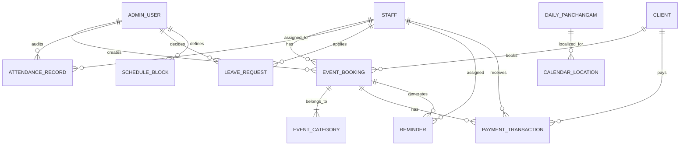

# Manthiragiri Jothidam — Data Model & Business Rules Specification

**Document Version:** 1.0.0  
**Project:** Manthiragiri Jothidam (மாந்திரகிரி ஜோதிடம்)  
**Target Audience:** Backend Engineering Team & Database Architects  
**Classification:** Technical Architecture Specification  

---

## 1. Entity-Relationship Architecture

The following diagram defines the relational architecture required to power all discovered features of **Manthiragiri Jothidam**:

---

## 2. Relational Entity Schemas

---

### 2.1. `admin_users`
Stores administrative accounts with chief authority over temple operations.

| Column | Type | Nullable | Description |
|---|---|---|---|
| `id` | VARCHAR(36) | No | Primary Key (UUIDv4) |
| `name_english` | VARCHAR(100) | No | Admin English name |
| `name_tamil` | VARCHAR(150) | No | Admin Tamil title (e.g. `சிவஸ்ரீ சுந்தரமூர்த்தி குருக்கள்`) |
| `phone` | VARCHAR(20) | No | Unique login mobile number |
| `email` | VARCHAR(150) | Yes | Contact email address |
| `password_hash` | VARCHAR(255) | No | Argon2 / bcrypt hash |
| `role` | VARCHAR(20) | No | Enum: `'super_admin'`, `'chief_admin'` |
| `avatar_url` | VARCHAR(500) | Yes | CDN URL |
| `address_tamil` | TEXT | Yes | Ashram / Peedam address |
| `status` | VARCHAR(20) | No | `'active'`, `'suspended'` |
| `created_at` | TIMESTAMPTZ | No | Creation timestamp |
| `updated_at` | TIMESTAMPTZ | No | Last update timestamp |

**Indexes:**
- `UNIQUE INDEX idx_admin_phone (phone)`

---

### 2.2. `staff` (Priests & Assistants)
Stores all ecclesiastical personnel: Chief Priests, Archakars, Officiating Priests, and Assistants.

| Column | Type | Nullable | Description |
|---|---|---|---|
| `id` | VARCHAR(36) | No | Primary Key (e.g., `'p-murugan'` or UUID) |
| `staff_code` | VARCHAR(30) | No | Unique code (e.g. `'PR-001'`) |
| `name_english` | VARCHAR(100) | No | English name |
| `name_tamil` | VARCHAR(150) | No | Tamil name |
| `designation_tamil` | VARCHAR(100) | No | e.g. `'தலைமை'`, `'அர்ச்சகர்'`, `'புரோகிதர்'`, `'உதவியாளர்'` |
| `designation_english` | VARCHAR(100) | No | e.g. `'Chief Priest'`, `'Archakar'`, `'Priest'`, `'Assistant'` |
| `role_badge` | VARCHAR(50) | No | Badge tag: `'SENIOR LEAD'`, `'HEAD ARCHAKAR'`, `'OFFICIATING'`, `'ASSISTANT'` |
| `role_category` | VARCHAR(20) | No | Classification: `'priest'` or `'assistant'` |
| `phone` | VARCHAR(20) | No | Unique mobile number used for login and client coordination |
| `password_hash` | VARCHAR(255) | No | Argon2 / bcrypt hash for Staff Portal login |
| `tradition_tamil` | VARCHAR(200) | Yes | e.g. `'வேத சைவ ஆகமம்'` |
| `certification_tamil` | VARCHAR(200) | Yes | e.g. `'அங்கீகரிக்கப்பட்ட கள குரு'` |
| `expertise_tamil` | VARCHAR(250) | Yes | e.g. `'ஹோமம் & கிரகப்பிரவேசம்'` |
| `languages_tamil` | VARCHAR(200) | Yes | e.g. `'தமிழ் & சமஸ்கிருதம்'` |
| `avatar_url` | VARCHAR(500) | Yes | Profile avatar CDN path |
| `status` | VARCHAR(20) | No | `'active'`, `'inactive'` |
| `created_at` | TIMESTAMPTZ | No | Record creation timestamp |
| `updated_at` | TIMESTAMPTZ | No | Last updated timestamp |

**Indexes:**
- `UNIQUE INDEX idx_staff_phone (phone)`
- `INDEX idx_staff_status (status)`

---

### 2.3. `clients`
Stores clients/devotees requesting astrology consultations, home homams, and temple poojas.

| Column | Type | Nullable | Description |
|---|---|---|---|
| `id` | VARCHAR(36) | No | Primary Key (UUIDv4) |
| `name` | VARCHAR(150) | No | Client name (e.g. `திரு. எஸ். கல்யாணசுந்தரம்`) |
| `phone` | VARCHAR(20) | No | Contact phone number |
| `email` | VARCHAR(150) | Yes | Optional email |
| `default_address` | TEXT | Yes | Primary home/venue address |
| `nakshatra` | VARCHAR(50) | Yes | Devotee birth star (e.g. `ரோகிணி`) |
| `rashi` | VARCHAR(50) | Yes | Devotee zodiac sign |
| `gothram` | VARCHAR(100) | Yes | Vedic family lineage |
| `created_at` | TIMESTAMPTZ | No | Registration date |

**Indexes:**
- `INDEX idx_clients_phone (phone)`
- `INDEX idx_clients_name (name)`

---

### 2.4. `event_bookings`
Core entity storing all pooja registrations, consultations, and ritual functions.

| Column | Type | Nullable | Description |
|---|---|---|---|
| `id` | VARCHAR(36) | No | Primary Key |
| `booking_number` | VARCHAR(30) | No | Unique human reference (e.g. `MJ-2026-10284`) |
| `date_key` | DATE | No | Scheduled event date (`YYYY-MM-DD`) |
| `start_time` | VARCHAR(20) | No | Start time string (e.g. `09:00 AM`) |
| `end_time` | VARCHAR(20) | No | End time string (e.g. `10:30 AM`) |
| `time_slot` | VARCHAR(60) | No | Combined display string (e.g. `09:00 AM - 10:30 AM`) |
| `title_tamil` | VARCHAR(250) | No | Event title (e.g. `கணபதி ஹோமம் & சங்கல்ப பூஜை`) |
| `title_english` | VARCHAR(250) | Yes | English title |
| `category` | VARCHAR(30) | No | `'jathagam'`, `'temple'`, `'outdoor'`, `'custom'` |
| `category_label_tamil` | VARCHAR(100) | No | e.g. `'ஜாதகம்'`, `'கோவில்'`, `'வெளி நிகழ்வு'` |
| `client_id` | VARCHAR(36) | Yes | Foreign Key → `clients.id` |
| `client_name_snapshot` | VARCHAR(150) | No | Client name at booking time |
| `client_phone_snapshot` | VARCHAR(20) | No | Client phone at booking time |
| `location_tamil` | TEXT | No | Venue address |
| `priest_id` | VARCHAR(36) | Yes | Foreign Key → `staff.id` (or `NULL` if external/custom priest) |
| `priest_name_snapshot` | VARCHAR(200) | No | Priest title at booking time |
| `status` | VARCHAR(20) | No | `'pending'`, `'confirmed'`, `'upcoming'`, `'completed'`, `'cancelled'` |
| `status_label_tamil` | VARCHAR(50) | No | e.g. `'உறுதி செய்யப்பட்டது'`, `'நிகழ்வில் உள்ளது'`, `'முடிவுற்றது'` |
| `notes_tamil` | TEXT | Yes | Preparation notes or sankalpam details |
| `total_event_charge` | NUMERIC(12,2) | No | Total fee agreed with client |
| `client_advance_amount` | NUMERIC(12,2) | No | Initial advance received from client |
| `client_total_received` | NUMERIC(12,2) | No | Total cumulative collections from client |
| `client_balance_amount` | NUMERIC(12,2) | No | Calculated: `total_event_charge - client_total_received` |
| `priest_total_pay` | NUMERIC(12,2) | No | Agreed dakshina/compensation for priest |
| `priest_advance_paid` | NUMERIC(12,2) | No | Advance disbursed to priest |
| `priest_balance_amount` | NUMERIC(12,2) | No | Calculated: `priest_total_pay - priest_advance_paid` |
| `completed_at` | TIMESTAMPTZ | Yes | Timestamp when marked completed |
| `completed_by_staff_id`| VARCHAR(36) | Yes | Foreign Key → `staff.id` |
| `completion_notes` | TEXT | Yes | Remarks entered at completion |
| `created_by_admin_id` | VARCHAR(36) | Yes | Foreign Key → `admin_users.id` |
| `created_at` | TIMESTAMPTZ | No | Booking creation timestamp |
| `updated_at` | TIMESTAMPTZ | No | Last update timestamp |

**Indexes:**
- `INDEX idx_bookings_date (date_key)`
- `INDEX idx_bookings_priest_date (priest_id, date_key)`
- `INDEX idx_bookings_status (status)`

---

### 2.5. `payment_transactions`
Auditable financial ledger tracking all receipts from clients and disbursements to priests. **Past records must never be modified or deleted.**

| Column | Type | Nullable | Description |
|---|---|---|---|
| `id` | VARCHAR(36) | No | Primary Key (UUIDv4) |
| `receipt_number` | VARCHAR(40) | No | Unique receipt code (e.g. `RCP-2026-0042`) |
| `event_booking_id` | VARCHAR(36) | No | Foreign Key → `event_bookings.id` |
| `transaction_type` | VARCHAR(30) | No | `'client_advance'`, `'client_balance_payment'`, `'priest_advance'`, `'priest_settlement'` |
| `party_type` | VARCHAR(20) | No | `'client'` or `'staff'` |
| `client_id` | VARCHAR(36) | Yes | Foreign Key → `clients.id` |
| `staff_id` | VARCHAR(36) | Yes | Foreign Key → `staff.id` |
| `amount` | NUMERIC(12,2) | No | Transaction amount in ₹ (must be `> 0`) |
| `payment_mode` | VARCHAR(30) | No | `'cash'`, `'upi'`, `'bank_transfer'`, `'cheque'` |
| `reference_number` | VARCHAR(100) | Yes | UPI UTR / Bank reference code |
| `remarks` | VARCHAR(250) | Yes | Payment notes |
| `received_or_paid_by` | VARCHAR(36) | No | Admin user who authorized entry |
| `created_at` | TIMESTAMPTZ | No | Immutable timestamp |

**Indexes:**
- `INDEX idx_payments_booking (event_booking_id)`
- `INDEX idx_payments_created_at (created_at)`

---

### 2.6. `attendance_records`
Daily attendance registry for all active priests and assistants.

| Column | Type | Nullable | Description |
|---|---|---|---|
| `id` | VARCHAR(70) | No | Compound Primary Key: `"{staff_id}_{date_key}"` |
| `staff_id` | VARCHAR(36) | No | Foreign Key → `staff.id` |
| `date_key` | DATE | No | Calendar date (`YYYY-MM-DD`) |
| `status` | VARCHAR(20) | No | Enum: `'present'`, `'absent'`, `'not_marked'` |
| `submission_time` | VARCHAR(20) | Yes | e.g. `'08:15 AM'` |
| `remarks` | VARCHAR(250) | Yes | Reason for absence or admin remarks |
| `source` | VARCHAR(30) | No | `'self_swipe'`, `'admin_manual'`, `'system_default'` |
| `is_sealed` | BOOLEAN | No | Default `false`. Set `true` once submitted by staff |
| `updated_by` | VARCHAR(100) | No | Identity of updater (`'Self (Staff Portal)'` or Admin Name) |
| `updated_at` | TIMESTAMPTZ | No | Last update timestamp |

**Constraints & Indexes:**
- `UNIQUE CONSTRAINT uq_staff_date (staff_id, date_key)`
- `INDEX idx_attendance_date (date_key)`

---

### 2.7. `leave_requests`
Formal leave governance for priests and assistants.

| Column | Type | Nullable | Description |
|---|---|---|---|
| `id` | VARCHAR(36) | No | Primary Key |
| `staff_id` | VARCHAR(36) | No | Foreign Key → `staff.id` |
| `start_date` | DATE | No | First date of leave (`YYYY-MM-DD`) |
| `end_date` | DATE | No | Final date of leave (`YYYY-MM-DD`) |
| `total_days` | INT | No | Calculated: `(end_date - start_date) + 1` |
| `leave_type` | VARCHAR(30) | No | `'personal'`, `'medical'`, `'temple_duty'`, `'festival'`, `'emergency'` |
| `reason` | TEXT | No | Reason submitted by staff member |
| `status` | VARCHAR(20) | No | `'pending'`, `'approved'`, `'rejected'` |
| `admin_remarks` | TEXT | Yes | Official response by Administrator |
| `decided_by_admin_id` | VARCHAR(36) | Yes | Foreign Key → `admin_users.id` |
| `decided_by_name` | VARCHAR(150) | Yes | Admin title at decision time |
| `decided_at` | DATE | Yes | Decision date |
| `applied_at` | DATE | No | Application submission date |
| `created_at` | TIMESTAMPTZ | No | Creation timestamp |

**Constraints & Indexes:**
- `CHECK (start_date <= end_date)`
- `INDEX idx_leaves_staff (staff_id)`
- `INDEX idx_leaves_status (status)`

---

### 2.8. `staff_reminders`
Operational checklists and ritual preparation alerts generated for staff members.

| Column | Type | Nullable | Description |
|---|---|---|---|
| `id` | VARCHAR(36) | No | Primary Key |
| `staff_id` | VARCHAR(36) | No | Foreign Key → `staff.id` |
| `event_booking_id` | VARCHAR(36) | Yes | Foreign Key → `event_bookings.id` |
| `title_english` | VARCHAR(200) | No | e.g. `'Pooja Materials Verification'` |
| `title_tamil` | VARCHAR(200) | No | e.g. `'பூஜை திரவியங்கள் சரிபார்த்தல்'` |
| `description_english`| TEXT | Yes | Detailed instructions |
| `description_tamil` | TEXT | Yes | Detailed instructions in Tamil |
| `date_key` | DATE | No | Target date |
| `scheduled_time` | VARCHAR(20) | Yes | e.g. `'08:00 AM'` |
| `status` | VARCHAR(20) | No | `'pending'`, `'completed'` |
| `completed_at` | TIMESTAMPTZ | Yes | Completion timestamp |

---

### 2.9. `schedule_blocks`
Enforces administrative date locks and maintenance days when bookings are disallowed.

| Column | Type | Nullable | Description |
|---|---|---|---|
| `id` | VARCHAR(36) | No | Primary Key |
| `date_key` | DATE | No | Blocked date |
| `reason_tamil` | VARCHAR(250) | No | Reason in Tamil (e.g. `'ஆலய வருடாந்திர பராமரிப்பு'`) |
| `reason_english` | VARCHAR(250) | Yes | Reason in English |
| `is_all_day` | BOOLEAN | No | Default `true` |
| `start_time` | VARCHAR(20) | Yes | Optional slot start if partial block |
| `end_time` | VARCHAR(20) | Yes | Optional slot end if partial block |
| `created_by` | VARCHAR(36) | No | Foreign Key → `admin_users.id` |

---

## 3. Financial Integrity & Calculation Rules

The application contains explicit arithmetic rules governing event costs and advances. The backend database must enforce these rules:

### Rule 1: Client Financial Balance
$$\text{clientBalanceAmount} = \max\Big(0, \;\text{totalEventCharge} - \text{clientTotalReceived}\Big)$$
- $\text{clientAdvanceAmount} \le \text{totalEventCharge}$ (Advance cannot exceed the total agreed charge).
- $\text{clientTotalReceived} \le \text{totalEventCharge}$ (Overpayments must be rejected or redirected to a security deposit).
- An initial booking creates a ledger entry in `payment_transactions` for `client_advance_amount` if $> 0$.

### Rule 2: Priest Financial Balance
$$\text{priestBalanceAmount} = \max\Big(0, \;\text{priestTotalPay} - \text{priestAdvancePaid}\Big)$$
- $\text{priestAdvancePaid} \le \text{priestTotalPay}$.
- Advances paid to priests create an immediate debit transaction under `payment_transactions`.

---

## 4. Attendance Governance & Business Rules

### Rule 1: Strict Compound Identity
Attendance is stored on a **strict one-record-per-staff-per-date** basis:
$$\text{Primary Key} = \text{staffId} + \text{"\_"} + \text{dateKey}$$
*Example:* `p-murugan_2026-10-29`. Any update on that date updates the existing record rather than inserting a duplicate row.

### Rule 2: Once-Per-Day Staff Swipe Enforcement
- On the Staff Portal (`StaffDashboardScreen`), once a staff member swipes `Present` or `Absent`, the record is marked `is_sealed = true`.
- Subsequent attempts to swipe or submit self-attendance for that date are rejected with `HTTP 409 Conflict`.
- Only Chief Administrators using `AttendanceManagementScreen` or `StaffAttendanceDetailScreen` have permission to modify or correct a sealed record.

### Rule 3: Monthly Attendance Percentage Formula
Verified against [`src/services/attendanceService.ts`](file:///d:/keerthik/WORK/mandragirijothidam/src/services/attendanceService.ts):
$$\text{markedDaysCount} = \text{presentCount} + \text{absentCount}$$
$$\text{attendancePercentage} = \begin{cases} 
\text{round}\left(\dfrac{\text{presentCount}}{\text{markedDaysCount}} \times 100\right), & \text{if } \text{markedDaysCount} > 0 \\ 
0, & \text{otherwise} 
\end{cases}$$
*Note:* `not_marked` days are excluded from the percentage denominator so unrecorded future days do not penalize attendance metrics.

---

## 5. Event Scheduling & Conflict Prevention Rules

### Rule 1: Blocked Dates
If `isDateBlocked(dateKey) == true`, booking registration must fail with message:  
`"இந்த தேதி கோவில் நிர்வாகத்தால் முடக்கப்பட்டுள்ளது (Date is blocked by temple administration)"`.

### Rule 2: Priest Double-Booking Prevention
A priest can officiate only **one** event per time window:
$$\text{Existing Booking: } [S_1, E_1] \quad \text{vs} \quad \text{New Booking: } [S_2, E_2]$$
$$\text{Collision occurs if: } S_2 < E_1 \quad \text{and} \quad E_2 > S_1 \quad \text{where } \text{priestId}_1 = \text{priestId}_2$$
If a collision is detected, registration fails with `HTTP 409 Conflict` stating:  
`"இந்த நேரத்தில் புரோகிதருக்கு ஏற்கனவே மற்றொரு நிகழ்வு ஒதுக்கப்பட்டுள்ளது"`.

---

## 6. Confirmed Business Rules vs Unconfirmed Questions

### Confirmed in Existing Codebase
1. **Dual Roles**: Admin and Staff belong to distinct authentication realms in the same mobile application.
2. **Staff Scope**: Priests and Assistants share the Staff Portal, but their designation badge (`SENIOR LEAD`, `HEAD ARCHAKAR`, `OFFICIATING`, `ASSISTANT`) is preserved.
3. **Attendance Isolation**: Tapping a priest's attendance card strictly loads their records and never leaks another staff member's history.
4. **Live Balances**: Client and priest payment balances are strictly non-negative.
5. **Leave Overlap Prevention**: Staff cannot apply for overlapping leaves if an existing active request is pending or approved.
6. **Bilingual Content**: Core ritual titles and panchangam data require both Tamil and English representations.

### Questions Requiring Product Owner / Backend Confirmation
> [!IMPORTANT]
> The following questions should be reviewed with the institution's management before final database implementation:

1. **GST & Invoicing**: Does the institution require formal GST tax invoices on temple event bookings, or are simple receipt numbers sufficient?
2. **Client Portal Access**: Will clients/devotees receive direct login access in a future release, or will bookings remain 100% staff-entered?
3. **Automated Reminders Provider**: Is WhatsApp Business API or an SMS gateway (e.g. Twilio, MSG91, Kaleyra) already contracted for client reminder dispatches?
4. **Online Payment Gateway**: Should the backend integrate Razorpay or Cashfree for client advances, or will all entries represent offline manual cash/UPI receipts?
5. **Staff Geofencing**: Should self-attendance swipes require GPS coordinates to verify that the priest is physically present at the temple complex?
