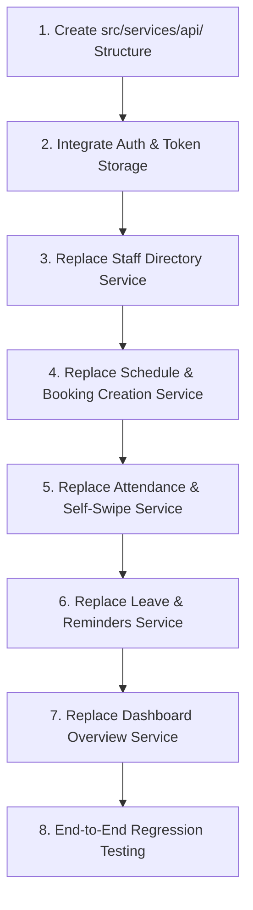

# Manthiragiri Jothidam — React Native Backend API Integration Guide

**Document Version:** 1.0.0  
**Project:** Manthiragiri Jothidam (மாந்திரகிரி ஜோதிடம்)  
**Target Audience:** React Native Mobile Engineers & Frontend Architects  
**Classification:** Technical Implementation & Integration Guide  

---

## 1. Executive Strategy & Non-Disruption Guarantees

The **Manthiragiri Jothidam** React Native application has completed its UI/UX, bilingual localization (Tamil / English), theme styling, keyboard-avoiding behaviors, and interactive workflows.

### 🛡️ Non-Disruption Golden Rules
1. **Zero Component Refactoring:** Under no circumstances should existing JSX layouts, visual styles, color tokens, typography, or component structures be altered when wiring up backend APIs.
2. **Preserve Service Boundaries:** Existing screens currently invoke service helper functions located in [`src/services/`](file:///d:/keerthik/WORK/mandragirijothidam/src/services/). Integration is achieved by **replacing mock resolution with HTTP client calls** inside these exact service files, retaining identical method signatures and TypeScript interfaces.
3. **Adapter Pattern (DTO to Domain Model):** The backend delivers standardized snake_case payloads (`event_charge`, `advance_paid`). The React Native adapter layer translates these into the application's existing camelCase domain types (`totalCharge`, `advancePaid`) before returning to the UI components.
4. **Graceful Fallback & Offline Resilience:** If the device loses internet connectivity, the application provides read-through caching via `@react-native-async-storage/async-storage` and presents user-friendly bilingual Tamil/English alerts.

---

## 2. Recommended Client Architecture & File Layout

To maintain separation of concerns without disturbing existing UI components, introduce an API networking client layer inside `src/services/api/`:

```
src/
├── services/
│   ├── api/
│   │   ├── client.ts             <-- Core Fetch / HTTP Client with Auth & Interceptors
│   │   ├── endpoints.ts          <-- Centralized URL Routes and Path Builders
│   │   ├── storage.ts            <-- AsyncStorage Token & Session Manager
│   │   ├── types.ts              <-- Backend DTO Contracts & Standard Envelopes
│   │   ├── errors.ts             <-- Standardized ApiError & Bilingual Mappers
│   │   └── adapters/
│   │       ├── eventAdapter.ts       <-- DTO <-> EventItem & Booking Payload
│   │       ├── staffAdapter.ts       <-- DTO <-> Priest
│   │       ├── attendanceAdapter.ts  <-- DTO <-> StaffAttendanceRecord
│   │       └── leaveAdapter.ts       <-- DTO <-> LeaveRequestItem
│   │
│   ├── authService.ts            <-- Existing service; updated to call api/client
│   ├── eventService.ts           <-- Existing service; updated to call api/client
│   ├── attendanceService.ts      <-- Existing service; updated to call api/client
│   ├── leaveService.ts           <-- Existing service; updated to call api/client
│   ├── reminderService.ts        <-- Existing service; updated to call api/client
│   ├── scheduleAvailabilityService.ts
│   └── tamilCalendarService.ts
```

---

## 3. Storage & Session Management (`src/services/api/storage.ts`)

The project already has `@react-native-async-storage/async-storage` installed. Implement session and JWT persistence as follows:

```typescript
// src/services/api/storage.ts
import AsyncStorage from '@react-native-async-storage/async-storage';

const STORAGE_KEYS = {
  AUTH_TOKEN: '@mandragiri_auth_token',
  REFRESH_TOKEN: '@mandragiri_refresh_token',
  USER_ROLE: '@mandragiri_user_role',
  USER_PROFILE: '@mandragiri_user_profile',
  OFFLINE_CACHE_PREFIX: '@mandragiri_cache_',
} as const;

export interface StoredUserProfile {
  id: string;
  name: string;
  role: 'admin' | 'priest' | 'assistant';
  phone: string;
  designation?: string;
  avatarUrl?: string;
}

export const StorageService = {
  async saveTokens(accessToken: string, refreshToken?: string): Promise<void> {
    const pairs: [string, string][] = [[STORAGE_KEYS.AUTH_TOKEN, accessToken]];
    if (refreshToken) {
      pairs.push([STORAGE_KEYS.REFRESH_TOKEN, refreshToken]);
    }
    await AsyncStorage.multiSet(pairs);
  },

  async getAccessToken(): Promise<string | null> {
    return AsyncStorage.getItem(STORAGE_KEYS.AUTH_TOKEN);
  },

  async getRefreshToken(): Promise<string | null> {
    return AsyncStorage.getItem(STORAGE_KEYS.REFRESH_TOKEN);
  },

  async saveUserProfile(profile: StoredUserProfile): Promise<void> {
    await AsyncStorage.multiSet([
      [STORAGE_KEYS.USER_ROLE, profile.role],
      [STORAGE_KEYS.USER_PROFILE, JSON.stringify(profile)],
    ]);
  },

  async getUserProfile(): Promise<StoredUserProfile | null> {
    const data = await AsyncStorage.getItem(STORAGE_KEYS.USER_PROFILE);
    return data ? JSON.parse(data) : null;
  },

  async clearSession(): Promise<void> {
    await AsyncStorage.multiRemove([
      STORAGE_KEYS.AUTH_TOKEN,
      STORAGE_KEYS.REFRESH_TOKEN,
      STORAGE_KEYS.USER_ROLE,
      STORAGE_KEYS.USER_PROFILE,
    ]);
  },

  // Cache helper for offline resilience
  async setCache(key: string, data: any): Promise<void> {
    try {
      await AsyncStorage.setItem(
        `${STORAGE_KEYS.OFFLINE_CACHE_PREFIX}${key}`,
        JSON.stringify({ timestamp: Date.now(), data })
      );
    } catch (e) {
      console.warn('Failed to save offline cache for key:', key, e);
    }
  },

  async getCache<T>(key: string, maxAgeMs = 3600000): Promise<T | null> {
    try {
      const raw = await AsyncStorage.getItem(`${STORAGE_KEYS.OFFLINE_CACHE_PREFIX}${key}`);
      if (!raw) return null;
      const parsed = JSON.parse(raw);
      if (Date.now() - parsed.timestamp > maxAgeMs) {
        return null; // Cache expired
      }
      return parsed.data as T;
    } catch {
      return null;
    }
  },
};
```

---

## 4. Centralized HTTP Network Client (`src/services/api/client.ts`)

Build an HTTP client with token injection, timeout handling, error normalization, and session refresh capabilities using the native Fetch API.

```typescript
// src/services/api/client.ts
import { StorageService } from './storage';
import { ApiError } from './errors';

// Base URL configuration (Supports Android Emulator, iOS Simulator, and Production)
// For Android Emulator, localhost is 10.0.2.2. For physical device, use host machine IP.
export const API_BASE_URL = __DEV__ 
  ? 'http://10.0.2.2:4000/api/v1' 
  : 'https://api.mandragirijothidam.com/api/v1';

const DEFAULT_TIMEOUT_MS = 15000;

interface RequestOptions extends RequestInit {
  timeoutMs?: number;
  skipAuth?: boolean;
}

export interface StandardApiResponse<T> {
  success: boolean;
  message: string;
  data: T;
  meta?: {
    total?: number;
    page?: number;
    limit?: number;
    timestamp?: string;
  };
}

export async function apiClient<T>(
  endpoint: string,
  options: RequestOptions = {}
): Promise<StandardApiResponse<T>> {
  const { timeoutMs = DEFAULT_TIMEOUT_MS, skipAuth = false, headers, ...rest } = options;

  const url = endpoint.startsWith('http') ? endpoint : `${API_BASE_URL}${endpoint}`;

  // 1. Prepare Headers
  const requestHeaders: Record<string, string> = {
    'Content-Type': 'application/json',
    'Accept': 'application/json',
    'Accept-Language': 'ta, en',
    ...((headers as Record<string, string>) || {}),
  };

  // 2. Attach Authorization Token
  if (!skipAuth) {
    const token = await StorageService.getAccessToken();
    if (token) {
      requestHeaders['Authorization'] = `Bearer ${token}`;
    }
  }

  // 3. Timeout Controller
  const controller = new AbortController();
  const timeoutId = setTimeout(() => controller.abort(), timeoutMs);

  try {
    const response = await fetch(url, {
      ...rest,
      headers: requestHeaders,
      signal: controller.signal,
    });

    clearTimeout(timeoutId);

    // 4. Handle 401 Unauthorized (Expired Session)
    if (response.status === 401) {
      await StorageService.clearSession();
      throw new ApiError({
        statusCode: 401,
        code: 'UNAUTHORIZED',
        message: 'Your session has expired. Please log in again.',
        messageTa: 'உங்கள் அமர்வு முடிந்துவிட்டது. மீண்டும் உள்நுழையவும்.',
      });
    }

    const json = await response.json();

    // 5. Handle Non-200 Responses
    if (!response.ok || !json.success) {
      throw new ApiError({
        statusCode: response.status,
        code: json?.error?.code || 'UNKNOWN_ERROR',
        message: json?.error?.message || json?.message || 'A network error occurred.',
        messageTa: json?.error?.message_ta || 'பிணைய பிழை ஏற்பட்டது.',
        details: json?.error?.details,
      });
    }

    return json as StandardApiResponse<T>;
  } catch (error: any) {
    clearTimeout(timeoutId);

    if (error.name === 'AbortError') {
      throw new ApiError({
        statusCode: 408,
        code: 'REQUEST_TIMEOUT',
        message: 'The request took too long to complete. Please check your connection.',
        messageTa: 'கோரிக்கை முடிவடைய அதிக நேரம் பிடித்தது. இணைய இணைப்பை சரிபார்க்கவும்.',
      });
    }

    if (error instanceof ApiError) {
      throw error;
    }

    // Network disconnection / Socket errors
    throw new ApiError({
      statusCode: 0,
      code: 'NETWORK_DISCONNECTED',
      message: 'Unable to connect to server. Please check your internet connection.',
      messageTa: 'சேவையகத்துடன் இணைக்க முடியவில்லை. இணைய இணைப்பைச் சரிபார்க்கவும்.',
    });
  }
}
```

---

## 5. Endpoints Catalog Constants (`src/services/api/endpoints.ts`)

```typescript
// src/services/api/endpoints.ts
export const ENDPOINTS = {
  // Authentication
  AUTH: {
    ADMIN_LOGIN: '/auth/admin/login',
    STAFF_LOGIN: '/auth/staff/login',
    VERIFY_OTP: '/auth/staff/verify-otp',
    LOGOUT: '/auth/logout',
    ME: '/auth/me',
  },

  // Dashboard
  DASHBOARD: {
    SUMMARY: '/dashboard/summary',
  },

  // Schedule & Bookings
  EVENTS: {
    LIST: '/events',
    DETAILS: (id: string) => `/events/${id}`,
    CREATE: '/events',
    UPDATE: (id: string) => `/events/${id}`,
    UPDATE_STATUS: (id: string) => `/events/${id}/status`,
    ASSIGN_PRIESTS: (id: string) => `/events/${id}/priests`,
    CANCEL: (id: string) => `/events/${id}/cancel`,
    SCHEDULE_DAY: (date: string) => `/events/schedule?date=${date}`,
  },

  // Staff Management
  STAFF: {
    LIST: '/staff',
    DROPDOWN: '/staff/dropdown',
    DETAILS: (id: string) => `/staff/${id}`,
    CREATE: '/staff',
    UPDATE: (id: string) => `/staff/${id}`,
    DELETE: (id: string) => `/staff/${id}`,
    AVAILABILITY: (id: string, date: string) => `/staff/${id}/availability?date=${date}`,
  },

  // Attendance
  ATTENDANCE: {
    DAILY_MATRIX: (date: string) => `/attendance/daily?date=${date}`,
    SUBMIT_DAILY: '/attendance/daily',
    STAFF_HISTORY: (staffId: string, month: string) => `/attendance/staff/${staffId}?month=${month}`,
    SELF_MARK: '/attendance/self-mark',
    SELF_STATUS: (date: string) => `/attendance/self-status?date=${date}`,
  },

  // Leaves
  LEAVES: {
    LIST: '/leaves',
    MY_LEAVES: '/leaves/my-leaves',
    APPLY: '/leaves',
    REVIEW: (id: string) => `/leaves/${id}/status`,
    BALANCE: (staffId: string) => `/leaves/balance/${staffId}`,
  },

  // Reminders
  REMINDERS: {
    LIST: '/reminders',
    TOGGLE: (id: string) => `/reminders/${id}/status`,
  },

  // Panchangam
  PANCHANGAM: {
    DAILY: (date: string, location?: string) => 
      `/panchangam/daily?date=${date}${location ? `&location=${location}` : ''}`,
  },

  // Profile & Settings
  ADMIN: {
    PROFILE: '/admin/profile',
    UPDATE_PROFILE: '/admin/profile',
    PEEDAM_SETTINGS: '/admin/peedam-settings',
  },
} as const;
```

---

## 6. Data Adapters & Model Mappers

The backend uses snake_case, whereas the existing React Native app components utilize camelCase interfaces defined in [`src/data/scheduleMockData.ts`](file:///d:/keerthik/WORK/mandragirijothidam/src/data/scheduleMockData.ts) and [`src/data/priestMockData.ts`](file:///d:/keerthik/WORK/mandragirijothidam/src/data/priestMockData.ts).

Adapters prevent any breaking changes to the UI screens.

### 6.1 Event Model Adapter (`src/services/api/adapters/eventAdapter.ts`)

```typescript
// src/services/api/adapters/eventAdapter.ts
import { EventItem, EventCategory, EventStatus, PaymentStatus } from '../../../data/scheduleMockData';

export interface ApiEventDto {
  id: string;
  booking_number: string;
  category: EventCategory;
  title: string;
  title_ta?: string;
  sub_category?: string;
  sub_category_ta?: string;
  client_name: string;
  client_phone: string;
  client_email?: string;
  client_address?: string;
  rashi?: string;
  nakshatram?: string;
  gothram?: string;
  event_date: string;
  start_time: string;
  end_time: string;
  venue_name: string;
  venue_address?: string;
  assigned_priests: Array<{
    staff_id: string;
    name: string;
    name_ta?: string;
    role: string;
    is_primary: boolean;
  }>;
  total_event_charge: number;
  client_total_received: number;
  client_balance_amount: number;
  priest_total_pay: number;
  priest_advance_paid: number;
  priest_balance_amount: number;
  event_status: EventStatus;
  payment_status: PaymentStatus;
  special_instructions?: string;
}

export function mapApiEventToEventItem(dto: ApiEventDto): EventItem {
  return {
    id: dto.id,
    bookingNumber: dto.booking_number,
    category: dto.category,
    title: dto.title,
    titleTa: dto.title_ta || dto.title,
    subCategory: dto.sub_category,
    subCategoryTa: dto.sub_category_ta,
    clientName: dto.client_name,
    clientPhone: dto.client_phone,
    clientEmail: dto.client_email,
    clientAddress: dto.client_address,
    rashi: dto.rashi,
    nakshatram: dto.nakshatram,
    gothram: dto.gothram,
    eventDate: dto.event_date,
    startTime: dto.start_time,
    endTime: dto.end_time,
    venueName: dto.venue_name,
    venueAddress: dto.venue_address,
    assignedPriests: dto.assigned_priests.map(p => ({
      staffId: p.staff_id,
      name: p.name,
      nameTa: p.name_ta || p.name,
      role: p.role,
      isPrimary: p.is_primary,
    })),
    totalEventCharge: Number(dto.total_event_charge),
    clientTotalReceived: Number(dto.client_total_received),
    clientBalanceAmount: Number(dto.client_balance_amount),
    priestTotalPay: Number(dto.priest_total_pay),
    priestAdvancePaid: Number(dto.priest_advance_paid),
    priestBalanceAmount: Number(dto.priest_balance_amount),
    eventStatus: dto.event_status,
    paymentStatus: dto.payment_status,
    specialInstructions: dto.special_instructions,
  };
}

export function mapBookingFormToApiPayload(formData: any) {
  return {
    category: formData.category,
    title: formData.title,
    title_ta: formData.titleTa,
    sub_category: formData.subCategory,
    sub_category_ta: formData.subCategoryTa,
    client_name: formData.clientName,
    client_phone: formData.clientPhone,
    client_email: formData.clientEmail,
    client_address: formData.clientAddress,
    rashi: formData.rashi,
    nakshatram: formData.nakshatram,
    gothram: formData.gothram,
    event_date: formData.eventDate,
    start_time: formData.startTime,
    end_time: formData.endTime,
    venue_name: formData.venueName,
    venue_address: formData.venueAddress,
    assigned_priest_ids: formData.assignedPriests?.map((p: any) => p.staffId) || [],
    total_event_charge: Number(formData.totalEventCharge || 0),
    client_advance_paid: Number(formData.clientAdvancePaid || formData.clientTotalReceived || 0),
    priest_total_pay: Number(formData.priestTotalPay || 0),
    priest_advance_paid: Number(formData.priestAdvancePaid || 0),
    payment_mode: formData.paymentMode || 'CASH',
    special_instructions: formData.specialInstructions,
  };
}
```

### 6.2 Staff Model Adapter (`src/services/api/adapters/staffAdapter.ts`)

```typescript
// src/services/api/adapters/staffAdapter.ts
import { Priest } from '../../../data/priestMockData';

export interface ApiStaffDto {
  id: string;
  name_en: string;
  name_ta: string;
  role: 'priest' | 'assistant';
  phone_number: string;
  experience_years: number;
  monthly_salary: number;
  status: 'active' | 'inactive' | 'on_leave';
  specializations: string[];
  specializations_ta: string[];
  avatar_url?: string;
  created_at: string;
}

export function mapApiStaffToPriest(dto: ApiStaffDto): Priest {
  return {
    id: dto.id,
    name: dto.name_en,
    nameTa: dto.name_ta,
    role: dto.role,
    phone: dto.phone_number,
    experience: `${dto.experience_years} years`,
    experienceYears: dto.experience_years,
    monthlySalary: Number(dto.monthly_salary),
    status: dto.status,
    specializations: dto.specializations || [],
    specializationsTa: dto.specializations_ta || [],
    avatarUrl: dto.avatar_url,
  };
}

export function mapPriestFormToApiPayload(priestData: any) {
  return {
    name_en: priestData.name,
    name_ta: priestData.nameTa || priestData.name,
    role: priestData.role,
    phone_number: priestData.phone,
    experience_years: Number(priestData.experienceYears || parseInt(priestData.experience, 10) || 0),
    monthly_salary: Number(priestData.monthlySalary || 0),
    specializations: priestData.specializations || [],
    specializations_ta: priestData.specializationsTa || [],
    avatar_url: priestData.avatarUrl,
  };
}
```

---

## 7. Drop-In Replacement for Existing Services

Each existing service file in [`src/services/`](file:///d:/keerthik/WORK/mandragirijothidam/src/services/) will transition from mock data to the backend API smoothly. Here are the direct drop-in implementations:

### 7.1 Authentication Service (`src/services/authService.ts`)

```typescript
// src/services/authService.ts
import { apiClient } from './api/client';
import { ENDPOINTS } from './api/endpoints';
import { StorageService } from './api/storage';
import { ApiError } from './api/errors';

export interface LoginResult {
  success: boolean;
  role: 'admin' | 'priest' | 'assistant';
  token?: string;
  user?: {
    id: string;
    name: string;
    phone: string;
    designation?: string;
  };
  error?: string;
}

export const authService = {
  /**
   * Authenticate Admin using Phone & Password
   */
  async loginAdmin(phone: string, pin: string): Promise<LoginResult> {
    try {
      const res = await apiClient<{
        token: string;
        refresh_token: string;
        user: {
          id: string;
          name: string;
          role: 'admin';
          phone: string;
        };
      }>(ENDPOINTS.AUTH.ADMIN_LOGIN, {
        method: 'POST',
        skipAuth: true,
        body: JSON.stringify({ phone, pin }),
      });

      const { token, refresh_token, user } = res.data;

      // Save session
      await StorageService.saveTokens(token, refresh_token);
      await StorageService.saveUserProfile({
        id: user.id,
        name: user.name,
        role: user.role,
        phone: user.phone,
      });

      return {
        success: true,
        role: 'admin',
        token,
        user,
      };
    } catch (err: any) {
      return {
        success: false,
        role: 'admin',
        error: err.message || 'Login failed',
      };
    }
  },

  /**
   * Authenticate Priest/Assistant using Mobile Number (Direct or OTP)
   */
  async loginStaff(phone: string, pin?: string): Promise<LoginResult> {
    try {
      const res = await apiClient<{
        token: string;
        refresh_token: string;
        user: {
          id: string;
          name: string;
          role: 'priest' | 'assistant';
          phone: string;
          designation: string;
        };
      }>(ENDPOINTS.AUTH.STAFF_LOGIN, {
        method: 'POST',
        skipAuth: true,
        body: JSON.stringify({ phone, pin }),
      });

      const { token, refresh_token, user } = res.data;

      // Save session
      await StorageService.saveTokens(token, refresh_token);
      await StorageService.saveUserProfile({
        id: user.id,
        name: user.name,
        role: user.role,
        phone: user.phone,
        designation: user.designation,
      });

      return {
        success: true,
        role: user.role,
        token,
        user,
      };
    } catch (err: any) {
      return {
        success: false,
        role: 'priest',
        error: err.message || 'Staff verification failed',
      };
    }
  },

  /**
   * Check if user is currently authenticated
   */
  async checkAuth(): Promise<{ isAuthenticated: boolean; role?: string; profile?: any }> {
    const token = await StorageService.getAccessToken();
    const profile = await StorageService.getUserProfile();
    return {
      isAuthenticated: !!token && !!profile,
      role: profile?.role,
      profile,
    };
  },

  /**
   * Log out and wipe local credentials
   */
  async logout(): Promise<void> {
    try {
      await apiClient(ENDPOINTS.AUTH.LOGOUT, { method: 'POST' });
    } catch {
      // Ignore network failure on logout
    } finally {
      await StorageService.clearSession();
    }
  },
};
```

---

### 7.2 Event & Booking Service (`src/services/eventService.ts`)

```typescript
// src/services/eventService.ts
import { apiClient } from './api/client';
import { ENDPOINTS } from './api/endpoints';
import { StorageService } from './api/storage';
import { mapApiEventToEventItem, mapBookingFormToApiPayload, ApiEventDto } from './api/adapters/eventAdapter';
import { EventItem } from '../data/scheduleMockData';

export const eventService = {
  /**
   * Fetch daily schedule timeline for a specific YYYY-MM-DD
   */
  async getDailySchedule(date: string): Promise<EventItem[]> {
    const cacheKey = `schedule_${date}`;
    try {
      const res = await apiClient<ApiEventDto[]>(ENDPOINTS.EVENTS.SCHEDULE_DAY(date));
      const events = res.data.map(mapApiEventToEventItem);
      // Update local cache
      await StorageService.setCache(cacheKey, events);
      return events;
    } catch (err) {
      // Fallback to offline cache if network fails
      const cached = await StorageService.getCache<EventItem[]>(cacheKey);
      if (cached) return cached;
      throw err;
    }
  },

  /**
   * Fetch a single event by ID
   */
  async getEventById(id: string): Promise<EventItem> {
    const res = await apiClient<ApiEventDto>(ENDPOINTS.EVENTS.DETAILS(id));
    return mapApiEventToEventItem(res.data);
  },

  /**
   * Create a new Pooja / Function Booking
   */
  async createEventBooking(formData: any): Promise<EventItem> {
    const payload = mapBookingFormToApiPayload(formData);
    const res = await apiClient<ApiEventDto>(ENDPOINTS.EVENTS.CREATE, {
      method: 'POST',
      body: JSON.stringify(payload),
    });
    return mapApiEventToEventItem(res.data);
  },

  /**
   * Update Event Status (SCHEDULED, IN_PROGRESS, COMPLETED, CANCELLED)
   */
  async updateEventStatus(id: string, status: string): Promise<EventItem> {
    const res = await apiClient<ApiEventDto>(ENDPOINTS.EVENTS.UPDATE_STATUS(id), {
      method: 'PATCH',
      body: JSON.stringify({ status }),
    });
    return mapApiEventToEventItem(res.data);
  },

  /**
   * Assign or Reassign Priests to an Event
   */
  async assignPriests(id: string, priestAssignments: Array<{ staffId: string; isPrimary: boolean }>): Promise<EventItem> {
    const res = await apiClient<ApiEventDto>(ENDPOINTS.EVENTS.ASSIGN_PRIESTS(id), {
      method: 'PATCH',
      body: JSON.stringify({
        assignments: priestAssignments.map(a => ({
          staff_id: a.staffId,
          is_primary: a.isPrimary,
        })),
      }),
    });
    return mapApiEventToEventItem(res.data);
  },
};
```

---

### 7.3 Attendance Management Service (`src/services/attendanceService.ts`)

```typescript
// src/services/attendanceService.ts
import { apiClient } from './api/client';
import { ENDPOINTS } from './api/endpoints';

export interface DailyAttendanceMatrixItem {
  staffId: string;
  name: string;
  nameTa: string;
  role: string;
  status: 'present' | 'absent' | 'not_marked';
  checkInTime?: string;
  isSealed: boolean;
}

export const attendanceService = {
  /**
   * Get Admin Attendance Matrix for a specific Date
   */
  async getDailyMatrix(date: string): Promise<DailyAttendanceMatrixItem[]> {
    const res = await apiClient<any[]>(ENDPOINTS.ATTENDANCE.DAILY_MATRIX(date));
    return res.data.map(item => ({
      staffId: item.staff_id,
      name: item.name_en,
      nameTa: item.name_ta,
      role: item.role,
      status: item.status,
      checkInTime: item.check_in_time,
      isSealed: item.is_sealed,
    }));
  },

  /**
   * Admin Bulk Submit / Update Attendance for a Date
   */
  async submitDailyAttendance(
    date: string, 
    records: Array<{ staffId: string; status: 'present' | 'absent' | 'not_marked' }>
  ): Promise<void> {
    await apiClient(ENDPOINTS.ATTENDANCE.SUBMIT_DAILY, {
      method: 'POST',
      body: JSON.stringify({
        date,
        records: records.map(r => ({
          staff_id: r.staffId,
          status: r.status,
        })),
      }),
    });
  },

  /**
   * Fetch month-wise attendance summary & date history for a specific staff
   */
  async getStaffAttendanceHistory(staffId: string, month: string): Promise<any> {
    const res = await apiClient<any>(ENDPOINTS.ATTENDANCE.STAFF_HISTORY(staffId, month));
    return res.data;
  },

  /**
   * Staff Self-Mark Attendance (Swipe or GPS)
   */
  async staffSelfMark(locationCoords?: { latitude: number; longitude: number }): Promise<any> {
    const res = await apiClient(ENDPOINTS.ATTENDANCE.SELF_MARK, {
      method: 'POST',
      body: JSON.stringify({
        method: locationCoords ? 'GPS' : 'MANUAL_SWIPE',
        coordinates: locationCoords,
      }),
    });
    return res.data;
  },
};
```

---

## 8. Bilingual Error Handling & Alert Normalizer (`src/services/api/errors.ts`)

When an API error occurs, users should see clear alerts in their selected language (Tamil or English).

```typescript
// src/services/api/errors.ts
import { Alert } from 'react-native';
import i18n from 'i18next';

export interface ApiErrorPayload {
  statusCode: number;
  code: string;
  message: string;
  messageTa: string;
  details?: Record<string, string[]>;
}

export class ApiError extends Error {
  statusCode: number;
  code: string;
  messageTa: string;
  details?: Record<string, string[]>;

  constructor(payload: ApiErrorPayload) {
    super(payload.message);
    this.name = 'ApiError';
    this.statusCode = payload.statusCode;
    this.code = payload.code;
    this.messageTa = payload.messageTa;
    this.details = payload.details;
  }

  /**
   * Get localized error message based on active i18next language
   */
  getLocalizedMessage(): string {
    const lang = i18n.language || 'en';
    if (lang.startsWith('ta')) {
      return this.messageTa || this.message;
    }
    return this.message;
  }
}

/**
 * Global Helper to display localized error Alert dialog
 */
export function showApiErrorAlert(error: unknown, fallbackTitle = 'Error') {
  if (error instanceof ApiError) {
    const title = i18n.language.startsWith('ta') ? 'பிழை' : 'Error';
    Alert.alert(title, error.getLocalizedMessage(), [{ text: 'OK' }]);
  } else if (error instanceof Error) {
    Alert.alert(fallbackTitle, error.message, [{ text: 'OK' }]);
  } else {
    Alert.alert(fallbackTitle, 'An unexpected error occurred.', [{ text: 'OK' }]);
  }
}
```

---

## 9. Form Submission Idempotency & Loading States

To avoid duplicate booking creations or multi-click race conditions in [`PoojaBookingFormModal.tsx`](file:///d:/keerthik/WORK/mandragirijothidam/src/components/common/PoojaBookingFormModal.tsx) and [`AddPriestModal.tsx`](file:///d:/keerthik/WORK/mandragirijothidam/src/components/priest/AddPriestModal.tsx):

### Pattern:
```typescript
const [isSubmitting, setIsSubmitting] = useState(false);

const handleSave = async () => {
  if (isSubmitting) return; // Prevent double taps

  setIsSubmitting(true);
  try {
    await eventService.createEventBooking(formData);
    onSuccess();
    onClose();
  } catch (error) {
    showApiErrorAlert(error);
  } finally {
    setIsSubmitting(false);
  }
};
```
- In the submit button:
  ```tsx
  <TouchableOpacity 
    onPress={handleSave} 
    disabled={isSubmitting}
    style={[styles.submitButton, isSubmitting && { opacity: 0.6 }]}
  >
    {isSubmitting ? (
      <ActivityIndicator color="#FFFFFF" size="small" />
    ) : (
      <Text style={styles.submitButtonText}>{t('save')}</Text>
    )}
  </TouchableOpacity>
  ```

---

## 10. Developer Integration & Environment Setup

### 10.1 Network Configuration for Local Development

When testing on Android Emulators or Physical Devices:

| Target Device | API Base URL | Special Notes |
|:---|:---|:---|
| **Android Emulator** | `http://10.0.2.2:4000/api/v1` | `10.0.2.2` aliases the development machine host loopback. |
| **iOS Simulator** | `http://localhost:4000/api/v1` | iOS Simulator shares the host network interface. |
| **Physical Phone (WiFi)** | `http://<YOUR_LAN_IP>:4000/api/v1` | Device and PC must be connected to the same WiFi network. |
| **Production Server** | `https://api.mandragirijothidam.com/api/v1` | Requires valid SSL TLS v1.2+. |

### 10.2 Android Cleartext Traffic (HTTP)
If testing with local `http://` backend instead of `https://`:
Ensure `android/app/src/main/AndroidManifest.xml` includes `android:usesCleartextTraffic="true"` under `<application>`:
```xml
<application
  ...
  android:usesCleartextTraffic="true">
```

---

## 11. Step-by-Step Migration Rollout Checklist

Follow this sequence to switch from Mock Data to Live Backend without regressions:



- [ ] **Step 1:** Add `client.ts`, `storage.ts`, `endpoints.ts`, and `errors.ts` under `src/services/api/`.
- [ ] **Step 2:** Update `authService.ts` to call `POST /api/v1/auth/admin/login` and verify token storage in AsyncStorage.
- [ ] **Step 3:** Update `PriestScreen.tsx` data fetching via `priestService.ts` to consume `GET /api/v1/staff`.
- [ ] **Step 4:** Wire `DailyScheduleScreen.tsx` to `GET /api/v1/events/schedule?date=YYYY-MM-DD`.
- [ ] **Step 5:** Wire `PoojaBookingFormModal.tsx` to `POST /api/v1/events` and verify modal closes smoothly upon receipt of 201 Created.
- [ ] **Step 6:** Wire `AttendanceManagementScreen.tsx` to `GET /api/v1/attendance/daily` and `POST /api/v1/attendance/daily`.
- [ ] **Step 7:** Wire `StaffAttendanceScreen.tsx` to `POST /api/v1/attendance/self-mark` for priest self-attendance.
- [ ] **Step 8:** Run complete test suite and verify UI layout, animations, bilingual text, and keyboard avoidance remain intact.
